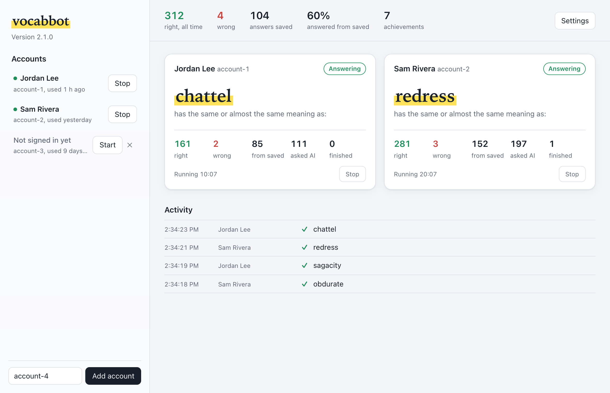

# Vocabulary.com Automation

Answers Vocabulary.com assignment questions in Chrome using an answer cache first and OpenAI second. Runs one or several browser sessions at once.



## Features

- **Desktop app** for macOS (Apple Silicon and Intel) and Windows: add accounts, start and stop them, and watch every session live
- **Multiple sessions**: each account gets its own Chrome window and profile, so several assignments or accounts run side by side
- **Saved accounts**: sign in to Vocabulary.com once per account; the app shows who's signed in to each
- **Shared answer cache** (SQLite): an answer learned in one session is reused by all of them, and by later runs
- Handles multiple-choice, sentence-context, image and spelling questions, countdown blockers, achievements and round screens
- Answers 3–5 seconds apart (adjustable), moves on after wrong picks, reloads the page if a question gets stuck

## Download

Get the zip for your computer from the [latest release](https://github.com/jackh54/vocabcom-Semi-Auto-Answer/releases/latest):

| Computer | File | Then |
|---|---|---|
| Mac with Apple Silicon (M1 and later) | `vocabbot-macos-apple-silicon.zip` | Unzip, drag **vocabbot** to Applications, open it |
| Intel Mac | `vocabbot-macos-intel.zip` | Same as above |
| Windows 10 or 11 | `vocabbot-windows-x64.zip` | Unzip, run **vocabbot.exe** (also runs on Windows on Arm) |

Not sure which Mac you have? Apple menu → **About This Mac**: "Chip: Apple M…" means Apple Silicon, "Processor: Intel" means Intel.

You also need Google Chrome. On Windows the app uses Microsoft Edge WebView2, which Windows 10 and 11 already include.

**First open.** The builds aren't code-signed yet, so the system asks once:
- **Mac:** "vocabbot cannot be opened…" → open **System Settings → Privacy & Security**, scroll down, click **Open Anyway**.
- **Windows:** "Windows protected your PC" → **More info** → **Run anyway**.

### Using the app

1. On first open, paste your OpenAI API key. It's checked with OpenAI and saved on your computer only.
2. Click **Add account**. A Chrome window opens on Vocabulary.com; sign in there. Next time it opens already signed in.
3. Open an assignment in that window. It starts answering on its own.
4. Start more accounts from the sidebar to run them side by side. **Stop** ends one; closing vocabbot ends them all.

**Settings** has the OpenAI model, the gap between answers, your API key, and buttons to open the data and log folders. The app keeps everything in your user folder, so updating is just replacing the app:
- Mac: `~/Library/Application Support/vocabbot`
- Windows: `%LOCALAPPDATA%\vocabbot`

## Run from source

### Requirements

- Python 3.10+
- Google Chrome
- An OpenAI API key

### Setup

```bash
pip install -r requirements.txt
cp config.example.json config.json
```

Put your key in `config.json` (or leave it blank and set `OPENAI_API_KEY`). `config.json` is gitignored.

### Usage

```bash
python main.py --gui             # the desktop app
python main.py                   # terminal version: choose accounts from a list (or add new ones)
python main.py -a alice -a bob   # run these accounts without the list
python main.py -n 3              # three sessions named session-1..3
```

With no flags you get the account picker:

```
  #   Account   Last used
  1   alice     2026-11-05 10:47
  2   bob       2026-11-04 18:20
Accounts (1): 1, carol
```

Type numbers or names, separated by commas, or `all`. A name that isn't in the list becomes a new account. Each account you pick gets its own session and window.

1. A Chrome window opens per account.
2. Sign in the first time you use an account; after that it opens already signed in. Then open an assignment. A session starts answering as soon as a question is on screen; no need to press anything.
3. When an assignment finishes, open another one in that window and it carries on.
4. Ctrl+C stops every session and closes only the bot's Chrome windows.

Closing a window ends just that session. Logs go to `logs/vocabbot.log`.

An account is just a folder: rename `data/profiles/<old>` to change its name, delete the folder to forget it (and its login). An account can only run in one place at a time; if another `main.py` is using it, the picker marks it "running elsewhere".

### Configuration (`config.json`)

| Key | Default | What it does |
|---|---|---|
| `openai_api_key` | | OpenAI key (falls back to `OPENAI_API_KEY`) |
| `model` | `gpt-4o-mini` | OpenAI model used when the cache has no answer |
| `chrome_options` | | Extra Chrome flags: `"disable_gpu": true` becomes `--disable-gpu`, `"window_size": "1280,900"` becomes `--window-size=1280,900` |
| `min_wait_time` / `max_wait_time` | 3 / 5 | Seconds between answers: each answer is submitted a random min to max seconds after the previous one (retries after a wrong pick too). Also the wait after a page reload |
| `log_level` | `INFO` | Log file level |

## Data

| Path | Contents |
|---|---|
| `data/vocabbot.db` | Answer cache and all-time counters (SQLite) |
| `data/profiles/<name>/` | Chrome profile per account (holds its login) |
| `logs/vocabbot.log` | Rotating log |

On first run, an existing `question_cache.json` and `statistics.json` are imported into the database once.

## Development

```bash
python -m pytest
```

When running from source, data lives in the repo folder (`config.json`, `data/`, `logs/`). Set `VOCABBOT_HOME` to use another folder.

### Releases

`.github/workflows/release.yml` builds the desktop app with PyInstaller (`packaging/vocabbot.spec`): `vocabbot.app` on Apple Silicon and Intel Mac runners, `vocabbot.exe` on Windows. Each build runs `--self-test` (loads every module without opening a window) before the zips go on a GitHub Release.

1. Bump `__version__` in `vocabbot/__init__.py`.
2. Commit, then tag and push: `git tag v2.1.1 && git push origin v2.1.1`.

The build fails if the tag doesn't match `__version__`. Builds use the exact versions in `constraints.txt`. Running the workflow by hand from the Actions tab builds without publishing.

Local build: `pip install -r requirements.txt pyinstaller -c constraints.txt && pyinstaller packaging/vocabbot.spec` (output in `dist/`). `packaging/make_icon.py` regenerates the icon (macOS, needs Pillow).

## Notes

1. This tool is for educational purposes only.
2. Make sure you are allowed to use automation on Vocabulary.com.
3. Keep your OpenAI API key out of git.

## License

MIT. See LICENSE.
